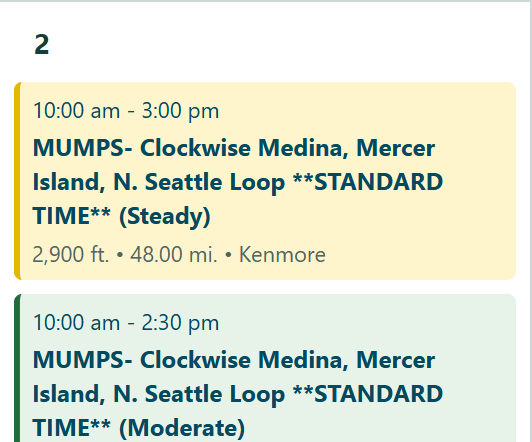
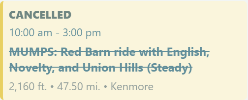

# Cascade Ride Calendar

A Chrome extension that adds a month calendar to [Cascade's ride search](https://cascade.org/rides-events/ride-event-search?f%5B0%5D=event_type%3A21).

## DISCLAIMER

This is 100% vibe-coded, use at your own risk. I tested it manually but have not read any of the code.

## Features

### A full month of rides

See the whole month in complete weeks, including rides in the visible days before and after the month and from every results page. Navigate with the month arrows, Today, or Go to date.


### Switch views without losing your place

The calendar opens by default. The **List / Calendar** toggle slides its highlight between views and stays in the same desktop position while the calendar expands to use the page width. Your view choice is saved across reloads and tabs. Reduced-motion preferences disable the animation.


### Expanded or compact days

Days expand to show every ride by default. The icon beside **Go to date** switches to compact, 220px-tall days with internal scrolling and remembers your choice. The full-month screenshot above uses compact mode.

See the [full expanded calendar](docs/calendar-expanded.png) for the default layout.

| Expanded (default) | Compact, with scrolling |
|---|---|
|  |  |

### CTS-based pace colors

Softly tinted ride cards and strong left borders use CTS-based pace colors, with the pace name also shown in the title.


### Multi-pace rides sorted by pace

Rides with the same name and start time sort from Easy through Self Paced, rather than alphabetically by the pace label.


### Cancelled rides clearly marked

Cancelled rides remain visible with a **CANCELLED** label and their name crossed out.


### Past rides fade

After a ride's start time, its card fades to 60% opacity. Hovering or keyboard-focusing it restores full opacity so you can read its details. This updates automatically every minute.

| Past ride | Hovered past ride |
|---|---|
|  |  |

### Filter by pace from the sidebar

Use Cascade's **By Pace** filters on the left to narrow the calendar without losing the month view.


### Works with the Dark Reader extension

The calendar adapts automatically to Dark Reader, keeping pace colors, controls, and text readable.


## Install

1. Open `chrome://extensions` and enable **Developer mode**.
2. Click **Load unpacked** and select this repository's `extension` folder.
3. Open Cascade's ride search; the calendar appears by default.

Use **Previous**, **Next**, **Today**, or **Go to date** to navigate. Navigation reloads the page with the sidebar's From/To filters set to the selected month, retaining search, pace, terrain, and other filters. The **List / Calendar** toggle at the top right highlights the selected view and switches between the calendar and Cascade's original list. The choice is saved in Cascade's local storage across reloads and tabs; calendar is the default until you choose otherwise.

Calendar mode uses the full available page width on desktop, with a compact filter sidebar. Month controls stay aligned with the calendar's left edge, while the view toggle stays anchored to the list-mode content's right edge to avoid jumping when switching. Switching back to the list restores Cascade's original page width and layout.

The calendar fetches all pages for the displayed weeks, not just the visible list page. Full-month date filters include the visible days from neighboring months; narrower sidebar date filters still apply. Days expand to show every ride by default. Use the expand/collapse icon next to **Go to date** to switch to compact, 220px-tall days with internal scrolling. This preference is saved in Cascade's local storage across page reloads and tabs. On small screens, scroll the calendar horizontally. Existing date filters narrow the initial month; apply sidebar filters using Cascade's Search button. Calendar requests select Free Group Ride (`event_type:21`), including virtual rides returned under that type. Times use Cascade's Pacific wall-clock dates, regardless of your computer's timezone.

Matching rides already on the page appear immediately. Additional results render as each page arrives, with up to three pages requested concurrently. Completed results are reused for 60 seconds when switching views. A spinner beside expand/collapse indicates that results are still loading, with loading announcements available to screen readers. A failed request keeps the available rides visible with a warning and Retry; empty results show a message. The ride count is not displayed.

No background service, external libraries, analytics, or extra extension permissions. Requests go only to Cascade; the original list remains accessible.

Dark Reader is supported: when it sets `data-darkreader-scheme="dark"` on the page, the calendar uses a dark palette and dark native date controls. Turning Dark Reader off restores the light palette. Dark Reader is a development-only dependency used to test compatibility; it is not bundled in the extension.

Ride cards use softly tinted backgrounds and strong left borders based on the final pace label in their title: Easy is pink, Leisurely red, Steady yellow, Moderate green, Brisk blue, Vigorous blue-leaning purple, Strenuous/Super Strenuous purple, and Self Paced gray. Dark Reader uses darker tints with the same pace hues. Unrecognized paces keep the default styling. Pace names remain in the title so colors are not the only cue.

Rides sort by start time, then name (excluding the final pace label). Same-name rides starting together sort Easy, Leisurely, Steady, Moderate, Brisk, Vigorous, Strenuous, Super Strenuous, then Self Paced.

Cancelled rides have their name crossed out and a separate **CANCELLED** label. Their time, details, pace colors, and link remain available. Cancellation is detected from Cascade's status tags or a cancellation marker in the ride title.

Rides display at 60% opacity after their start time, checked every minute using Cascade's timestamp offsets. Past rides intentionally have reduced text contrast; hovering or keyboard-focusing one restores full opacity.

## Development

```powershell
npm ci
npx playwright install chromium
npm run check
npm test
```

Playwright's browser timezone is `America/Los_Angeles` (PST/PDT). Tests use local responses modeled on the live site's Drupal markup. The live page was explored with Playwright to verify card selectors, ISO timestamps, date-filter format, and pagination. A future Cascade redesign may require updating these selectors.

## Privacy

See the [privacy policy](PRIVACY.md) for the extension's data handling, Cascade requests, local preference storage, and removal instructions. No user data is sent to the developer.

## Chrome Web Store

See the [submission guide and listing text](store/listing.md). Build the upload ZIP with `./scripts/package.ps1`. Store-sized screenshots are in `store`; the original calendar-and-bike icon is in `assets/icon.svg`, with PNGs bundled in `extension/icons`.

To regenerate the icon PNGs after changing the SVG, run `node ./scripts/generate-icons.js`.

To refresh screenshots from the live site, run `node ./scripts/capture-screenshots.js`, then `node ./scripts/generate-store-images.js`. The capture script loads the actual unpacked extension in Pacific time, captures the next month and visible neighboring dates, and uses currently published rides for pace and cancellation examples. It also captures view states, expanded/compact days, past-ride fading, loading, and actual Dark Reader rendering. If suitable examples are unavailable, it stops rather than inventing ride data.

The generator produces five 1280 x 800 store images: a full-month overview and readable feature close-ups, plus five overview graphics in `share`. Screenshot sources are in `docs` and `assets`. All screenshot assets use live Cascade content; the site may change after capture.

Before uploading a replacement ZIP, increase `extension/manifest.json`'s version above the last uploaded version and rebuild the package. Listing-only changes do not require a new ZIP.

## Contributing

See [CONTRIBUTING.md](CONTRIBUTING.md) for development setup, testing, and pull request guidelines.

## License

The project's original code and artwork are licensed under the [MIT License](LICENSE.md). You may use, modify, redistribute, and sell them, including in closed-source projects, provided you preserve the copyright and license notices.

Third-party names, logos, and Cascade ride content are not relicensed by this project.

The expand/collapse icons use [Framework7 Icons](https://github.com/framework7io/framework7-icons), under [MIT](extension/icons/framework7-LICENSE.txt).
