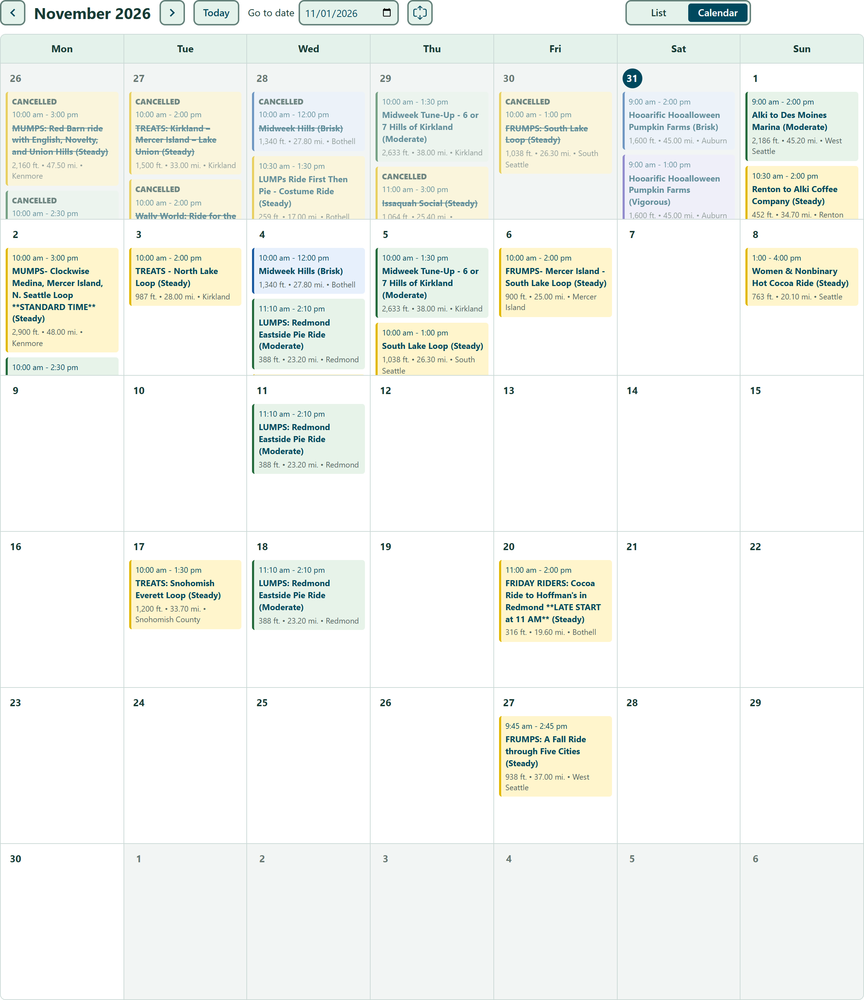
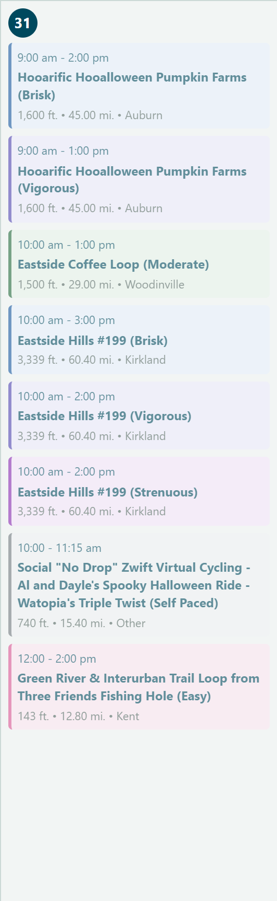
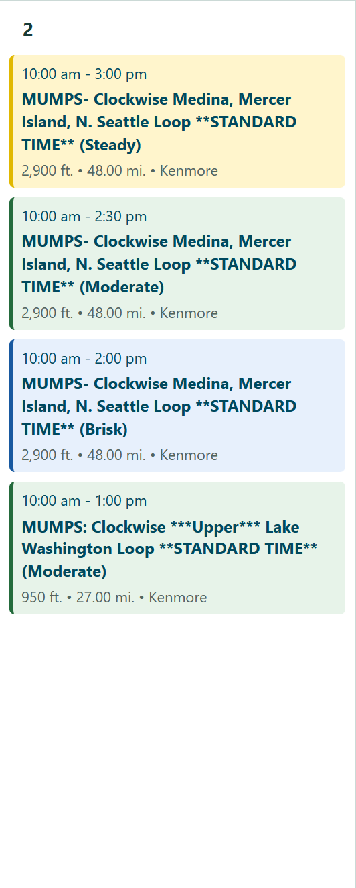
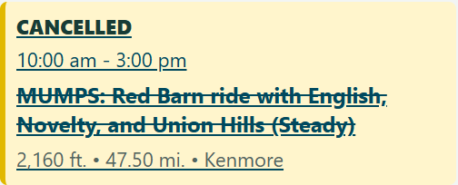
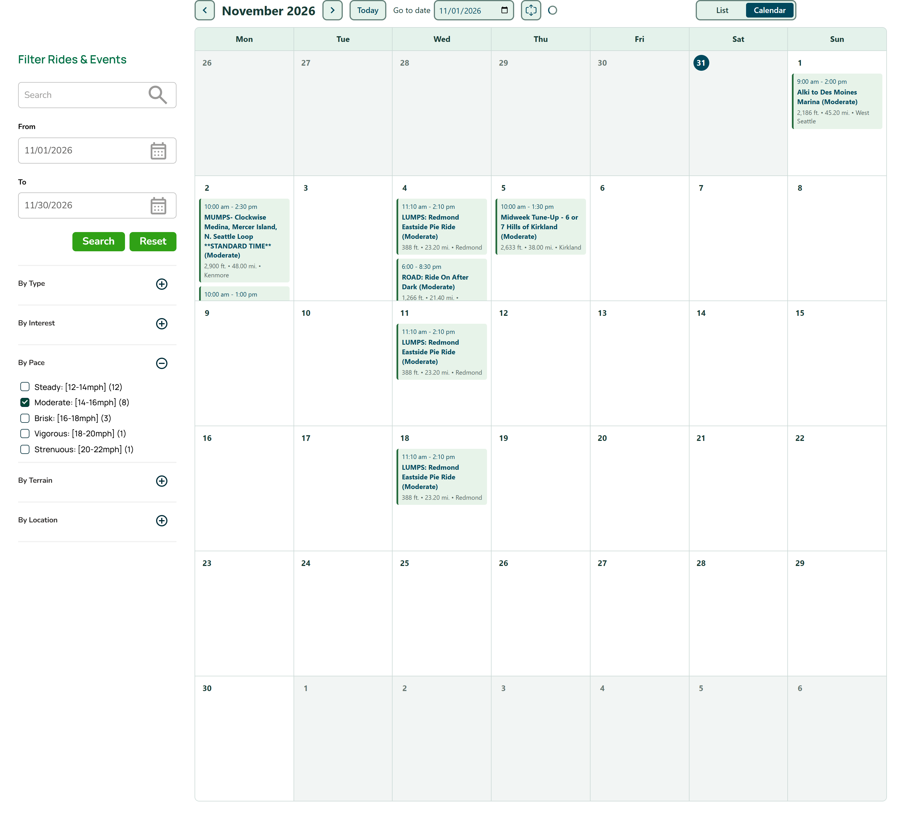
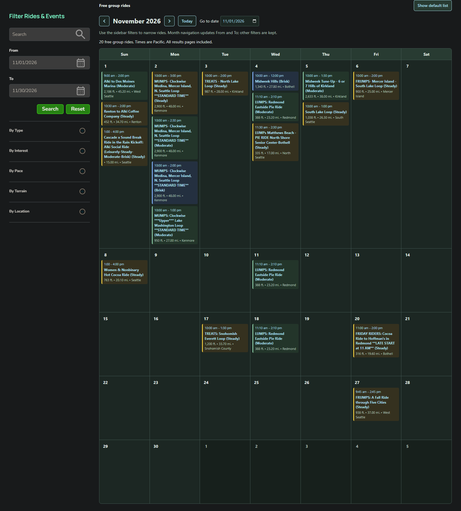

# Cascade Ride Calendar

A Chrome extension that adds a month calendar to [Cascade's ride search](https://cascade.org/rides-events/ride-event-search?f%5B0%5D=event_type%3A21).

## DISCLAIMER

This is 100% vibe-coded, use at your own risk. I tested it manually but have not read any of the code.

## Features

### A full month of rides

See the whole month, including rides from every results page. Navigate with the month arrows, Today, or Go to date.



### CTS-based pace colors

Softly tinted ride cards and strong left borders use CTS-based pace colors, with the pace name also shown in the title.



### Multi-pace rides sorted by pace

Rides with the same name and start time sort from Easy through Self Paced, rather than alphabetically by the pace label.



### Cancelled rides clearly marked

Cancelled rides remain visible with a **CANCELLED** label and their name crossed out.



### Filter by pace from the sidebar

Use Cascade's **By Pace** filters on the left to narrow the calendar without losing the month view.



### Works with the Dark Reader extension

The calendar adapts automatically to Dark Reader, keeping pace colors, controls, and text readable.



## Install

1. Open `chrome://extensions` and enable **Developer mode**.
2. Click **Load unpacked** and select this repository's `extension` folder.
3. Open Cascade's ride search; the calendar appears by default.

Use **Previous**, **Next**, **Today**, or **Go to date** to navigate. Navigation reloads the page with the sidebar's From/To filters set to the selected month, retaining search, pace, terrain, and other filters. The **List / Calendar** toggle at the top right highlights the selected view and switches between the calendar and Cascade's original list. The choice is saved in Cascade's local storage across reloads and tabs; calendar is the default until you choose otherwise.

Calendar mode uses the full available page width on desktop, with a compact filter sidebar. Switching back to the list restores Cascade's original page width and layout.

The calendar fetches all pages for the displayed month, not just the visible list page. Days expand to show every ride by default. Use the expand/collapse icon next to **Go to date** to switch to compact, 220px-tall days with internal scrolling. This preference is saved in Cascade's local storage across page reloads and tabs. On small screens, scroll the calendar horizontally. Existing date filters narrow the initial month; apply sidebar filters using Cascade's Search button. Calendar requests select Free Group Ride (`event_type:21`), including virtual rides returned under that type. Times use Cascade's Pacific wall-clock dates, regardless of your computer's timezone.

Matching rides already on the page appear immediately. Additional results render as each page arrives, with up to three pages requested concurrently. Completed results are reused for 60 seconds when switching views. The loading status explicitly indicates when results are incomplete; a failed request keeps the available rides visible with a warning and Retry.

No background service, external libraries, analytics, or extra extension permissions. Requests go only to Cascade; the original list remains accessible.

Dark Reader is supported: when it sets `data-darkreader-scheme="dark"` on the page, the calendar uses a dark palette and dark native date controls. Turning Dark Reader off restores the light palette. Dark Reader is a development-only dependency used to test compatibility; it is not bundled in the extension.

Ride cards use softly tinted backgrounds and strong left borders based on the final pace label in their title: Easy is pink, Leisurely red, Steady yellow, Moderate green, Brisk blue, Vigorous blue-leaning purple, Strenuous/Super Strenuous purple, and Self Paced gray. Dark Reader uses darker tints with the same pace hues. Unrecognized paces keep the default styling. Pace names remain in the title so colors are not the only cue.

Rides sort by start time, then name (excluding the final pace label). Same-name rides starting together sort Easy, Leisurely, Steady, Moderate, Brisk, Vigorous, Strenuous, Super Strenuous, then Self Paced.

Cancelled rides have their name crossed out and a separate **CANCELLED** label. Their time, details, pace colors, and link remain available. Cancellation is detected from Cascade's status tags or a cancellation marker in the ride title.

Rides display at 60% opacity after their start time, checked every minute using Cascade's timestamp offsets. Past rides intentionally have reduced text contrast; hovering or keyboard-focusing one restores full opacity.

## Development

```powershell
npm ci
npx playwright install chromium
npm run check
npm test
```

Playwright's browser timezone is `America/Los_Angeles` (PST/PDT). Tests use local responses modeled on the live site's Drupal markup. The live page was explored with Playwright to verify card selectors, ISO timestamps, date-filter format, and pagination. A future Cascade redesign may require updating these selectors.

## Chrome Web Store

See the [submission guide and listing text](store/listing.md). Build the upload ZIP with `.\scripts\package.ps1`. Store-sized screenshots are in `store`; the original calendar-and-bike icon is in `assets\icon.svg`, with PNGs bundled in `extension\icons`.

To regenerate the icon PNGs after changing the SVG, run `node .\scripts\generate-icons.js`.

To regenerate store-sized images from the README's live screenshots, run `node .\scripts\generate-store-images.js`.

## Contributing

See [CONTRIBUTING.md](CONTRIBUTING.md) for development setup, testing, and pull request guidelines.

## License

The project's original code and artwork are licensed under [GNU GPLv3-only](https://www.gnu.org/licenses/gpl-3.0.html) (`GPL-3.0-only`). Commercial use is permitted; distributed derivatives must comply with GPLv3, including its corresponding-source requirements.

Third-party names, logos, and Cascade ride content are not relicensed by this project.

The expand/collapse icons use Google's [Material Symbols](https://github.com/google/material-design-icons), under [Apache-2.0](extension/icons/material-symbols-LICENSE.txt).
